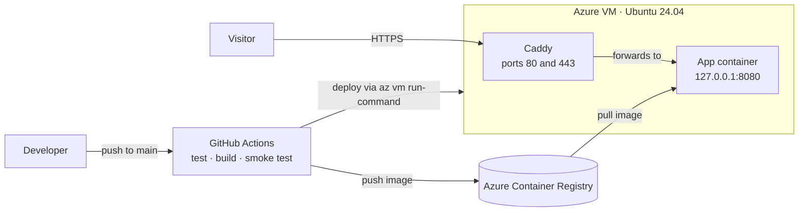

# Electro — Group 2 Capstone

[](https://github.com/MarvDev-Arch/Group-2-Capstone-Repo/actions/workflows/deploy.yml)

**Live site:** https://group2capstone.name.ng

Electro is an electronics-store website packaged with Docker and deployed to an Azure Linux VM.

- **Terraform** creates the Azure infrastructure.
- **GitHub Actions** tests and deploys every push to `main` automatically.
- **Caddy** serves the site over HTTPS with a free certificate that renews itself.

This README is a complete guide: follow the steps in order and you will end up with your own copy of the site running on your own domain over HTTPS.

---

## Contents

1. [How it works](#how-it-works)
2. [What you need](#what-you-need)
3. [Step 1 — Get the code](#step-1--get-the-code)
4. [Step 2 — Choose your names](#step-2--choose-your-names)
5. [Step 3 — Create an SSH key](#step-3--create-an-ssh-key)
6. [Step 4 — Build the Azure infrastructure](#step-4--build-the-azure-infrastructure)
7. [Step 5 — Point your domain at the VM](#step-5--point-your-domain-at-the-vm)
8. [Step 6 — Prepare the VM](#step-6--prepare-the-vm)
9. [Step 7 — Connect GitHub to Azure](#step-7--connect-github-to-azure)
10. [Step 8 — Deploy](#step-8--deploy)
11. [Everyday use](#everyday-use)
12. [Troubleshooting](#troubleshooting)
13. [Team](#team)

---

## How it works



1. You push code to the `main` branch.
2. GitHub Actions builds the site into a Docker image and tests it.
3. The image is stored in Azure Container Registry (ACR).
4. GitHub tells the VM to download the new image and restart the app.
5. Visitors reach Caddy over HTTPS, and Caddy passes them to the app.

No passwords are stored anywhere: GitHub signs in to Azure with OIDC, and the VM pulls images with its own managed identity.

---

## What you need

| Item | Notes |
|---|---|
| **Azure subscription** | You need the **Owner** role, because the setup creates role assignments |
| **GitHub account** | To fork this repo and run Actions |
| **A domain name** | With access to its DNS settings (for example from QServers, Namecheap, Cloudflare) |
| **Git** | https://git-scm.com/downloads — on Windows this also installs **Git Bash** |
| **Azure CLI** | https://learn.microsoft.com/cli/azure/install-azure-cli |
| **Terraform 1.5 or newer** | https://developer.hashicorp.com/terraform/install |

> **Windows users:** run every command in this guide in **Git Bash**, not PowerShell. Before any `az` command, run this once per Git Bash window, or Azure IDs get mangled:
>
> ```bash
> export MSYS_NO_PATHCONV=1
> ```

Check the tools are installed:

```bash
git --version
az --version
terraform -version
```

---

## Step 1 — Get the code

1. On GitHub, click **Fork** at the top of this repo to make your own copy.
2. Clone your fork (replace `<your-username>`):

```bash
git clone https://github.com/<your-username>/Group-2-Capstone-Repo.git
cd Group-2-Capstone-Repo
```

---

## Step 2 — Choose your names

A few names must be unique to you. Decide them now and write them down:

| Name | Rules | Example |
|---|---|---|
| **Registry name** | Globally unique across Azure, 5–50 characters, lowercase letters and numbers only | `electroacr7391` |
| **Project name** | Used to name the resource group, VM and network | `group2-capstone` |
| **Domain** | A domain you own | `mysite.com` |

Now edit two files.

**`infra/main.tf`** — find the `azurerm_container_registry` resource and set your registry name:

```hcl
  name                = "electroacr7391"
```

**`.github/workflows/deploy.yml`** — update the `env:` block near the top:

```yaml
env:
  ACR_NAME: electroacr7391                          # your registry name
  IMAGE: electroacr7391.azurecr.io/capstone-app     # your registry name + /capstone-app
  RESOURCE_GROUP: group2-capstone-rg                # <project name>-rg
  VM_NAME: group2-capstone-vm                       # <project name>-vm
  CONTAINER_NAME: myapp
  SITE_URL: https://mysite.com                      # your domain
```

Commit these changes:

```bash
git add infra/main.tf .github/workflows/deploy.yml
git commit -m "Set my registry name and domain"
git push
```

> The push starts a pipeline run that will fail at the deploy step, because Azure isn't set up yet. That's expected — ignore it.

---

## Step 3 — Create an SSH key

The VM only accepts SSH key logins. If you don't already have `~/.ssh/id_ed25519`, create one:

```bash
ssh-keygen -t ed25519
```

Press **Enter** at every question to accept the defaults.

---

## Step 4 — Build the Azure infrastructure

**4.1 Sign in to Azure**

```bash
az login
az account list -o table                     # find your subscription ID
az account set --subscription "<subscription-id>"
```

**4.2 Find your public IP** (only this IP will be allowed to SSH in):

```bash
curl -s https://api.ipify.org
```

**4.3 Create `infra/terraform.tfvars`** with your values. The first three lines are required:

```hcl
subscription_id     = "<subscription-id>"
admin_cidr          = "<your-public-ip>/32"
ssh_public_key_path = "~/.ssh/id_ed25519.pub"

# Optional — these are the defaults from variables.tf; uncomment to change them
# project_name   = "group2-capstone"
# location       = "West US 3"
# vm_size        = "Standard_D2s_v4"
# admin_username = "azureuser"
```

> Always set `ssh_public_key_path`: the default in `variables.tf` points to a path on one team member's computer.
>
> If you change `project_name`, your resource group and VM names change too (`<project_name>-rg`, `<project_name>-vm`) — use the new names everywhere this guide says `group2-capstone-rg` or `group2-capstone-vm`, including `deploy.yml`.

> ⚠️ **Never commit `terraform.tfvars` or `terraform.tfstate`.** They contain your private settings. Keep them on your computer only.

**4.4 Create everything**

```bash
cd infra
terraform init
terraform plan
terraform apply
```

Type `yes` when asked. This takes about 3–5 minutes and creates the resource group, network, firewall, VM, container registry and permissions.

**4.5 Get the VM's public IP**

```bash
az vm show -d -g group2-capstone-rg -n group2-capstone-vm --query publicIps -o tsv
cd ..
```

Write this IP down — you need it in the next two steps.

---

## Step 5 — Point your domain at the VM

In your domain provider's DNS settings, add two records:

| Type | Host / Name | Value | TTL |
|---|---|---|---|
| A | `@` | `<VM public IP>` | 300 |
| A | `www` | `<VM public IP>` | 300 |

Delete any other A records for `@` or `www` (providers often add a "parking" record).

Check it worked (this can take from a few minutes to a few hours):

```bash
nslookup mysite.com 8.8.8.8
```

✅ The answer should show your VM's IP. Continue with Step 6 while you wait.

---

## Step 6 — Prepare the VM

**6.1 Connect**

```bash
ssh -i ~/.ssh/id_ed25519 azureuser@<VM public IP>
```

The prompt changes to `azureuser@group2-capstone-vm:~$`. **All commands in Step 6 run here, on the VM.**

**6.2 Install the Azure CLI** (the deploy script uses it to pull images):

```bash
curl -sL https://aka.ms/InstallAzureCLIDeb | sudo bash
```

**6.3 Install Caddy**

```bash
sudo apt update
sudo apt install -y caddy
```

**6.4 Configure Caddy** — replace `mysite.com` with your domain in **both** places:

```bash
sudo tee /etc/caddy/Caddyfile > /dev/null <<'EOF'
mysite.com {
    reverse_proxy 127.0.0.1:8080
}

www.mysite.com {
    redir https://mysite.com{uri} permanent
}
EOF

sudo caddy validate --config /etc/caddy/Caddyfile
sudo systemctl reload caddy
```

Caddy gets the HTTPS certificate automatically as soon as your domain points at the VM.

**6.5 Leave the VM**

```bash
exit
```

---

## Step 7 — Connect GitHub to Azure

This gives GitHub Actions permission to deploy, without storing any password. Run these on **your computer** (Git Bash on Windows), from the repo folder.

**7.1 Set your details** (edit the first four lines):

```bash
export MSYS_NO_PATHCONV=1               # Windows Git Bash only, harmless elsewhere
GH_OWNER="<your-github-username>"
GH_REPO="Group-2-Capstone-Repo"
ACR_NAME="electroacr7391"
RG="group2-capstone-rg"
VM="group2-capstone-vm"
```

**7.2 Create the GitHub identity in Azure**

```bash
appId=$(az ad app create --display-name "$GH_REPO-github" --query appId -o tsv)
az ad sp create --id "$appId"
echo "Client ID: $appId"
```

**7.3 Trust your repo's `main` branch**

GitHub can identify your repo in two formats, so create both.

First, open `https://api.github.com/repos/<your-github-username>/Group-2-Capstone-Repo` in your browser and note two numbers: the **`id`** at the very top (the repo ID), and the **`id`** inside the `"owner"` section (the owner ID). Then:

```bash
REPO_ID="<repo id>"
OWNER_ID="<owner id>"

cat > cred1.json <<EOF
{"name":"github-main","issuer":"https://token.actions.githubusercontent.com",
 "subject":"repo:$GH_OWNER/$GH_REPO:ref:refs/heads/main","audiences":["api://AzureADTokenExchange"]}
EOF

cat > cred2.json <<EOF
{"name":"github-main-ids","issuer":"https://token.actions.githubusercontent.com",
 "subject":"repo:$GH_OWNER@$OWNER_ID/$GH_REPO@$REPO_ID:ref:refs/heads/main","audiences":["api://AzureADTokenExchange"]}
EOF

az ad app federated-credential create --id "$appId" --parameters @cred1.json
az ad app federated-credential create --id "$appId" --parameters @cred2.json
rm cred1.json cred2.json
```

**7.4 Grant the permissions it needs**

```bash
acrId=$(az acr show -n "$ACR_NAME" --query id -o tsv)
vmId=$(az vm show -g "$RG" -n "$VM" --query id -o tsv)

az role assignment create --assignee "$appId" --role AcrPush --scope "$acrId"
az role assignment create --assignee "$appId" --role Reader --scope "$acrId"
az role assignment create --assignee "$appId" --role "Virtual Machine Contributor" --scope "$vmId"
```

**7.5 Add the secrets to GitHub**

Print the three values:

```bash
echo "AZURE_CLIENT_ID       = $appId"
echo "AZURE_TENANT_ID       = $(az account show --query tenantId -o tsv)"
echo "AZURE_SUBSCRIPTION_ID = $(az account show --query id -o tsv)"
```

On GitHub, open your fork → **Settings → Secrets and variables → Actions → New repository secret**, and add each one with exactly these names:

| Secret name | Value |
|---|---|
| `AZURE_CLIENT_ID` | from the output above |
| `AZURE_TENANT_ID` | from the output above |
| `AZURE_SUBSCRIPTION_ID` | from the output above |

---

## Step 8 — Deploy

1. Wait until `nslookup` from Step 5 shows your VM's IP.
2. Wait 2–3 minutes after Step 7 so the permissions take effect.
3. On GitHub, open **Actions → Build and Deploy → Run workflow → Run workflow**.

The run takes about 3 minutes. ✅ Both jobs turn green and the last step prints:

```
Live at https://mysite.com (version ...)
```

Open your domain in a browser — you should see the store with a padlock 🔒.

From now on, **every push to `main` deploys automatically.**

---

## Everyday use

| Task | How |
|---|---|
| Update the site | Edit files, commit, `git push` to `main` |
| Test a change without deploying | Open a pull request — only the tests run |
| Roll back | Actions tab → an older green run → **Re-run all jobs** |
| Run the site on your computer | `docker build -t capstone-app .` then `docker run --rm -p 8080:80 capstone-app`, open http://localhost:8080 |
| Pause the VM to save money | `az vm deallocate -g group2-capstone-rg -n group2-capstone-vm` |
| Start it again | `az vm start -g group2-capstone-rg -n group2-capstone-vm` |
| Run a command on the VM without SSH | `az vm run-command invoke -g group2-capstone-rg -n group2-capstone-vm --command-id RunShellScript --scripts "docker ps"` |
| Delete everything | `cd infra && terraform destroy` |

- The site, container and Caddy all start by themselves after the VM restarts.
- **Don't push while the VM is stopped** — the deploy step will fail.
- After `terraform destroy` and a new `terraform apply`, the VM gets a **new IP**: repeat Steps 5, 6 and 7.4.

---

## Troubleshooting

| Problem | Cause | Fix |
|---|---|---|
| SSH: `Connection timed out` | Your home IP changed | Update `admin_cidr` in `terraform.tfvars` with your new IP, then `terraform apply` |
| `MissingSubscription` on a role command | Git Bash changed the Azure ID | `export MSYS_NO_PATHCONV=1`, then rerun |
| `bash: =: command not found` | PowerShell syntax in Git Bash | In Bash, write `name=$(command)` with no spaces around `=` |
| Pipeline: `AADSTS700213 No matching federated identity` | Subject doesn't match what GitHub sent | Copy the `subject claim` line from the failed log and create a federated credential with exactly that subject |
| Pipeline: `AuthorizationFailed` | A permission is missing | Redo Step 7.4, wait 3 minutes, re-run the failed job |
| Pipeline: `Deployment script failed on the VM` | Azure CLI missing on the VM, or VM stopped | Check Step 6.2 and that the VM is running |
| `terraform apply`: registry name not available | Someone else has that name | Pick another name and update Step 2's two files |
| Browser: `Could not resolve host` | DNS not set or not spread yet | Check Step 5 with `nslookup`; wait and retry |
| Browser: `502 Bad Gateway` | Caddy works but the app isn't running | Run the workflow (Step 8), or `docker ps` on the VM |
| No padlock / certificate error | Caddy couldn't get a certificate yet | Make sure DNS is correct, then on the VM: `sudo systemctl restart caddy` and `sudo journalctl -u caddy -f` |

---

## Project structure

```
.
├── .github/workflows/deploy.yml   # CI/CD pipeline
├── infra/                         # Terraform: network, firewall, VM, registry, permissions
│   ├── main.tf
│   ├── variables.tf
│   ├── outputs.tf
│   └── terraform.tfvars           # your private settings — never commit
├── css/ scss/ js/ lib/ img/       # site assets
├── index.html shop.html ...       # site pages
├── Dockerfile                     # nginx:alpine image serving the site
└── .dockerignore                  # keeps infra/ and Terraform files out of the image
```

---

## Team

| Name | GitHub |
|---|---|
| Ifeanyi Akpati (repository owner) | [@MarvDev-Arch](https://github.com/MarvDev-Arch) |
| Chijioke Emele | [@EmeleCj](https://github.com/EmeleCj) |
| Emmanuel Idoga | [@Nuelidoga](https://github.com/Nuelidoga) |
| Odunayo Christiana Shobayo | [@Christianawind](https://github.com/Christianawind) |
| Olatoye Ogunjobi | — |
| Felix | — |

## Credits

Site design based on the [Electro Bootstrap template](https://themewagon.com/themes/electro-bootstrap/) by ThemeWagon.

## License

See [LICENSE.txt](LICENSE.txt).
